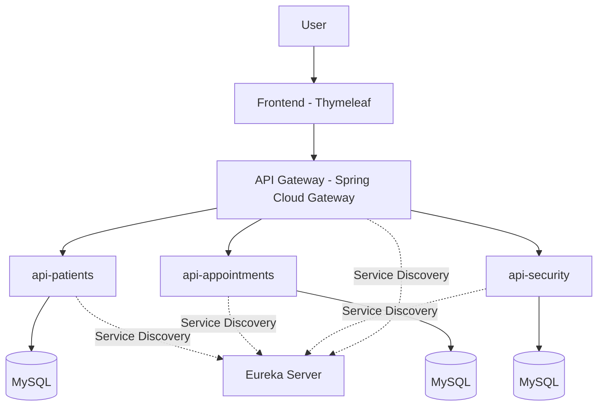

# Medical Management System

## About the Project

This project is a microservices-based medical management system developed with Java and Spring Boot. Its purpose is to provide a modular backend architecture for managing medical information and interactions between different system components.

The application is structured around independent services, allowing different responsibilities to be separated and maintained individually. An API Gateway handles incoming requests, while Eureka provides service discovery between the microservices.

## Current Implementation

The project currently includes the following components:

### 1. Patient Management (`api-patients`)

Responsible for handling patient-related information and operations. It provides the backend functionality associated with patient management and uses MySQL for data persistence.

### 2. Appointment Management (`api-appointments`)

Dedicated to managing medical appointments. It operates as an independent service within the application architecture and uses MySQL for data persistence.

### 3. Security (`api-security`)

Handles authentication and security-related functionality, providing a dedicated component for access control within the system.

### 4. API Gateway (`apim`)

Acts as the entry point for incoming API requests. It manages request routing and forwards requests to their corresponding backend services.

### 5. Service Discovery (`eureka-server`)

Provides service registration and discovery through Netflix Eureka. It allows the microservices to identify available service instances without relying on manually configured addresses.

### 6. Frontend (`frontend`)

Built with Thymeleaf, it provides the user interface through which users interact with the application and its backend services. It is not optimized because this project is focused on backend developement.

## Architecture

The application follows a microservices architecture in which each service has a specific responsibility.

The main communication flow is organized as follows:

- The frontend communicates with the API Gateway.
- The API Gateway routes incoming requests to the appropriate backend service.
- Eureka maintains the registry of available microservices.
- The backend services handle their respective business operations.
- MySQL provides data persistence for the patient, appointment and security services.

## Technologies

| Area | Technology |
|---|---|
| Backend | Java / Spring Boot |
| Frontend | Thymeleaf |
| API Gateway | Spring Cloud Gateway |
| Service Discovery | Netflix Eureka |
| Database | MySQL |
| Testing | JUnit, Mockito |
| Build Tools | Maven |

## Configuration

Each component uses an `application.properties` file to define its application-specific settings.

| Component | Configuration | Description |
|---|---|---|
| `api-patients` | `application.properties` | Database connection, server port and Eureka client settings. |
| `api-appointments` | `application.properties` | Database connection, server port and Eureka client settings. |
| `api-security` | `application.properties` | Authentication and security settings. |
| `apim` | `application.properties` | Gateway routes and service discovery settings. |
| `eureka-server` | `application.properties` | Discovery server port and registration settings. |
| `frontend` | `application.properties` | Backend/API base URL. |

Sensitive information, such as database credentials and authentication secrets, should be supplied through environment variables rather than committed configuration files.

## Project Status

This repository documents the current development of the system, including its microservices structure, service discovery, API Gateway, frontend and database integration.

Additional functionality and improvements will be incorporated as development progresses.
